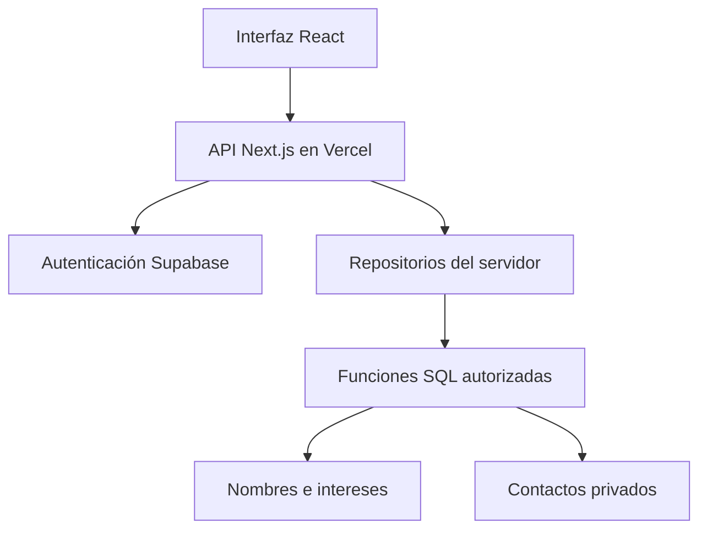

# Arquitectura

| Capa | Ubicación | Responsabilidad |
|---|---|---|
| Interfaz | `app/*.tsx`, `app/unete`, `app/admin` | Presentación, formularios, canvas; no acceso directo a tablas |
| Contratos compartidos | `lib/contracts` | Tipos públicos, validación y lista permitida de campos |
| Transporte HTTP | `app/api` | Origen, tamaño, formato, autenticación y respuestas sin caché |
| Autorización y sesión | `lib/server/auth.ts`, `supabase.ts` | Identidad validada por el proveedor; permisos y MFA |
| Acceso a datos | `lib/server/repositories` | Único punto de consulta a funciones SQL |
| Dominio y persistencia | `supabase/migrations` | Propiedad del perfil, validaciones, transacciones, consultas y auditoría |

Los módulos de servidor importan `server-only`: Next.js bloquea su inclusión accidental en componentes del navegador. El frontend y backend comparten repositorio para desplegar juntos, pero tienen responsabilidades y contratos separados. No se necesita un servidor independiente ni una conexión PostgreSQL persistente en Vercel; las consultas usan la API HTTPS de Supabase.

## Fronteras de información

`kolab_private.network_profiles` guarda identidad interna, identificador público aleatorio, nombre, intereses y visibilidad. `kolab_private.member_contacts` guarda teléfono y contexto privado. El correo se obtiene de la cuenta verificada en `auth.users`, nunca de un campo enviado por el navegador.

Todas las tablas están fuera del esquema expuesto, sin privilegios para `anon` o `authenticated`, con RLS habilitado y sin políticas permisivas. Las únicas entradas son RPC específicas con `SECURITY DEFINER`, `search_path` vacío, nombres cualificados, sin SQL dinámico y permisos explícitos.

La función pública `kolab_network()` solo proyecta `id`, `name`, `interests` de perfiles visibles; el repositorio vuelve a reconstruir esa lista permitida. La consulta propia siempre deriva el propietario de `auth.uid()`. La consulta administrativa verifica la tabla privada de administradores y el claim firmado `aal2` dentro de PostgreSQL, además de la comprobación del servidor.

## Sesiones y renderizado

OTP y MFA pasan por el backend. Los tokens quedan en cookies HttpOnly, Secure en producción y SameSite=Lax. `getUser()` verifica la identidad con el proveedor antes de cada operación privada. El proxy renueva sesiones; no es la barrera de autorización.

El sitio usa renderizado dinámico y navegación de documento completo para renovar la CSP con nonce por respuesta. No hay caché compartida de respuestas con sesión ni de contactos. Los recursos estáticos mantienen el tratamiento estándar de Next/Vercel.

## Contenido preservado

`content/original-site.json`, `content/home-sections.json`, `content/migration-manifest.json` y `public/images/original` conservan las páginas e imágenes migradas. El HTML editorial procede de archivos versionados y sanitizados; nunca se inserta HTML enviado por integrantes. Las fichas de integrantes usan texto escapado por React.

La red muestra hasta 500 perfiles recientes e indica el total; el panel administrativo pagina de 50 en 50. Para redes significativamente mayores, ampliar con agregación o navegación espacial sin aumentar la información pública.
